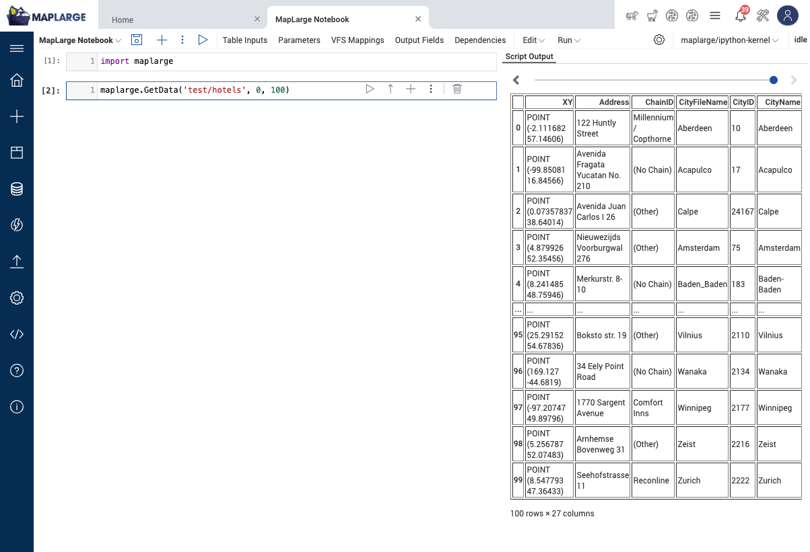

# MapLarge Notebook Kernels

Docker images that run the IPython kernel behind a MapLarge Notebook. The MapLarge server starts a container from one of these images, mounts the Jupyter connection file into it, and connects to the kernel. Use this repository as the starting point for your own kernel images.



## Kernels

The kernels stack. Each derived image starts from its parent image and adds packages.

| Kernel | Image | Parent | Adds | Platforms |
| --- | --- | --- | --- | --- |
| Base CPU | `maplarge/ipython-kernel-base` | `python:3.13-slim` | Kernel user, entrypoint, pandas, pyarrow, boto3, MLflow client | amd64, arm64 |
| CPU Analytics | `maplarge/ipython-kernel` | Base CPU | GeoPandas, Shapely, rasterio, scikit-learn, SciPy, OpenCV, Polars, matplotlib and related packages | amd64, arm64 |
| AI/ML GPU | `maplarge/ipython-kernel-gpu` | CPU Analytics | PyTorch, torchvision, torchmetrics, ONNX, scikit-image | amd64 |

The images publish to Docker Hub (`maplarge/...`) and to GitHub Container Registry (`ghcr.io/maplarge/...`) with the release version and `latest` as tags.

See `kernels/<kernel>/requirements.in` for the explicit package list of each kernel and `kernels/<kernel>/requirements.txt` for the exact versions that the image installs.

## Repository layout

| Path | Content |
| --- | --- |
| `common/` | Files that every kernel image needs: the entrypoint, `maplarge.py`, `mlgetfiles.py`, and the `maplargeclient` and `mlflowmaplarge` Python packages. |
| `kernels/<kernel>/Dockerfile` | The image definition. A derived Dockerfile takes the parent image as the build argument `PARENT_IMAGE`. |
| `kernels/<kernel>/requirements.in` | The explicit packages that the kernel adds. A derived file includes the parent list with `-r` and uses the parent lock as constraints with `-c`. |
| `kernels/<kernel>/requirements.txt` | The lock file that pip installs. Generated. Do not edit by hand. |
| `docker-bake.hcl` | The build definition. Builds the kernels in parent order. The Makefile and CI both use it. |
| `scripts/smoke-test.sh` | Checks a built image: non-root user, entrypoint, file listing helper, and every explicit package import. |

## How MapLarge runs the image

The MapLarge server:

1. Starts a container from the image.
2. Mounts a volume at `/tmp/config` with `connection-file.json` (the Jupyter connection file) and `maplarge-config.json`.
3. Runs the entrypoint with the connection file path as the first argument.
4. Sets the environment variables `ML_CONFIG` (path of `maplarge-config.json`) and `ML_ENABLE_MLFLOW` (`0` turns the MLflow hook off).
5. Connects to the kernel ports in the connection file.

The entrypoint copies the connection file into the working directory and starts `ipykernel` with the MapLarge client preloaded.

The server also runs `python3 mlgetfiles.py` and `import maplarge` relative to the working directory. Keep these files in the working directory of any image you build.

## Non-root user

All images run as the user `maplarge` (uid 1000, gid 1000). The working directory and `HOME` are `/home/maplarge`. Group 0 has the same rights as the user on the home directory, so platforms that run containers with an arbitrary uid in group 0 (for example OpenShift) also work.

The Python site-packages directory is read-only for the kernel user. A `pip install` from a notebook installs to the user site under `/home/maplarge/.local` instead.

## Build and test

Requirements: Docker with Buildx, and GNU Make. Run all commands from the repository root.

```
make build-cpu-analytics   # builds maplarge/ipython-kernel-base:dev, then maplarge/ipython-kernel:dev
make test-cpu-analytics    # smoke test
```

Replace `cpu-analytics` with `base-cpu` or `ai-ml-gpu`. A build also builds the parents. Local builds target the platform of your machine.

To build every kernel for every platform and push the tags, use bake directly:

```
VERSION=4.142.0 LATEST=true docker buildx bake --push
```

## Change a package

1. Edit `kernels/<kernel>/requirements.in`. Add a package to the lowest kernel that needs it. The kernels above inherit it.
2. Run `make lock-<kernel>`. The lock resolves in the `python:3.13-slim` image on linux/amd64 with the parent lock as constraints.
3. Run `make lock-<kernel>` for each kernel above the one you changed, in order. `make lock-all` locks all three in order.
4. Run `make build-<kernel>` and `make test-<kernel>`.
5. Commit the `requirements.in` and `requirements.txt` files together.

Packages that are not in a kernel install on demand. Use the notebook dependency option in MapLarge, or build your own image (next section).

## Build your own kernel image

Start from the published kernel that is closest to your needs and add packages. Switch to root for the install and back to the kernel user afterwards.

```Dockerfile
FROM maplarge/ipython-kernel:4.142.0

USER root
RUN pip3 install --no-cache-dir seaborn==0.13.2 statsmodels==0.14.4
USER 1000:1000
```

Rules for a derived image:

- Do not change the working directory, the entrypoint, or the files in `/home/maplarge`.
- End the Dockerfile with `USER 1000:1000` so the kernel runs as the non-root user.
- Pin package versions. Unpinned installs change from build to build.
- For a larger package set, copy the layout of this repository: a `requirements.in` that starts with `-r` and `-c` lines that point to the parent kernel files, and a generated `requirements.txt`.

Register the image in MapLarge Container Management and select it for a notebook.

## GPU kernel

The GPU kernel installs `torch` from PyPI. The lock pins the CUDA and cuDNN libraries that this `torch` version needs as `nvidia-*` packages. The image has no CUDA toolkit and no `nvcc`.

The host needs an NVIDIA driver that supports the CUDA version in the lock, and the NVIDIA container runtime. To target an older driver, add an index URL for the matching wheels to `kernels/ai-ml-gpu/requirements.in` and re-lock:

```
--extra-index-url https://download.pytorch.org/whl/cu126
```

The GPU image is about 11 GB. Pull it once per host.

## Releases

CI builds all three kernels on every pull request. Nothing is pushed.

A published GitHub release builds the kernels again and pushes them to Docker Hub and GitHub Container Registry:

| Release type | Tags pushed |
| --- | --- |
| Pre-release | `<tag>` |
| Release | `<tag>` and `latest` |

Workloads that use pull policy Always on a `latest` tag pull the new image at the next start. To test the pipeline or a new image without that effect:

1. Publish a pre-release, for example `4.142.0-rc1`.
2. Point a test workload image record at that tag and run notebooks against it.
3. Publish a normal release when the test passes. This moves `latest`.

Announce package removals before a release that moves `latest`.

## Version pins

| Pin | Reason |
| --- | --- |
| `mlflow-skinny>=2.12,<2.13` | Version that `mlflowmaplarge` supports. |
| `pandas<3` | pandas 3 changes default behaviors and predates mlflow 2.12. |
| `setuptools<80.9` | mlflow 2.12 imports `pkg_resources`. setuptools 80.9 and later print a warning on every import, and 82 removes the module. |

Lift the pandas and setuptools pins with the mlflow upgrade.
